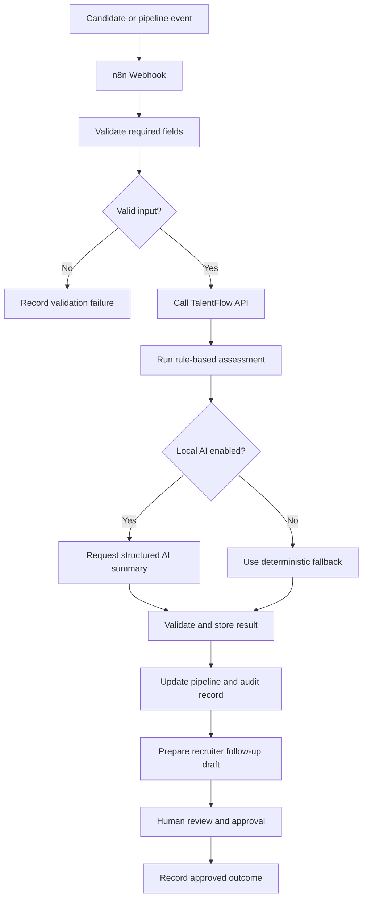
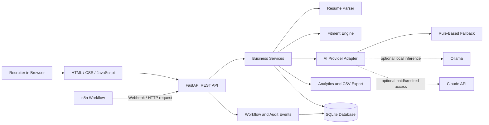

# TalentFlow AI — Recruitment Automation Platform

> **Status:** In progress  
> **Project type:** Browser-based recruitment workflow MVP  
> **Primary goal:** Demonstrate practical skills in recruitment operations, Python APIs, AI-assisted assessment, and workflow automation using a local-first architecture.

TalentFlow AI is a recruitment automation MVP designed to help recruiters manage job requisitions, organize candidate resumes, review candidate-to-job fitment, track the recruitment pipeline, monitor interviews, and generate operational reports. The intended design combines a Python/FastAPI backend, SQLite storage, a lightweight JavaScript frontend, an AI-provider adapter, and optional n8n workflow orchestration.

**Accuracy note:** This README documents the target MVP and its architecture while development is in progress. A feature should be described as implemented only after its code exists and has been tested. External systems such as CEIPAL, Google/Microsoft calendars, email/WhatsApp delivery, TallyPrime, and CredFlow are not considered connected unless a working, authorized integration is implemented and verified.

---

## Table of Contents

- [Project Goals](#project-goals)
- [Business Context](#business-context)
- [MVP Scope](#mvp-scope)
- [AI and Automation Strategy](#ai-and-automation-strategy)
- [Architecture](#architecture)
- [Core Workflows](#core-workflows)
- [Technology Stack](#technology-stack)
- [Project Structure](#project-structure)
- [Local Development Setup](#local-development-setup)
- [Configuration](#configuration)
- [API Design](#api-design)
- [Data Model](#data-model)
- [Testing and Quality](#testing-and-quality)
- [Privacy, Security, and Responsible AI](#privacy-security-and-responsible-ai)
- [Known Limitations](#known-limitations)
- [Roadmap](#roadmap)
- [Portfolio Demonstration Plan](#portfolio-demonstration-plan)
- [Contribution Workflow](#contribution-workflow)
- [License and Third-Party Tools](#license-and-third-party-tools)

## Project Goals

TalentFlow AI is intended to demonstrate how a recruitment workflow can be made more consistent and easier to monitor without removing the recruiter from important decisions.

The project aims to:

1. Provide a single browser-based workspace for sample candidates, job requisitions, assessment results, interview events, and pipeline status.
2. Extract usable text from common resume formats and preserve the source text needed for recruiter verification.
3. Compare a candidate's documented experience and skills with a job's requirements, showing matched criteria, missing criteria, and supporting evidence.
4. Use deterministic rules as a reliable baseline and make AI-generated summaries an optional, validated layer.
5. Automate repeatable tasks through webhooks and n8n workflows, with human approval before external communication.
6. Provide searchable records, pipeline/funnel analytics, CSV exports, and a basic audit trail.
7. Keep local development possible with no mandatory paid AI API or hosted service.

## Business Context

Recruitment teams often handle resumes, job requirements, client submissions, interviews, and operational reports across separate tools. This can make it difficult to answer basic questions consistently:

- Which candidates have been reviewed for a particular job?
- Which requirements are supported by a candidate's resume, and which are not evidenced?
- Where is each candidate in the recruitment process?
- Which interviews are scheduled or need follow-up?
- Which client submissions are waiting for feedback beyond a defined threshold?
- How are sources, pipeline stages, and conversion rates performing?

TalentFlow AI focuses on a small, demonstrable subset of this workflow. It is not a replacement for an enterprise Applicant Tracking System (ATS), and it does not claim to reproduce every module in the supplied enterprise BRD.

## MVP Scope

The status labels below describe the **target scope**, not proof of completion. Update them as each feature is implemented and tested.

| Area | Target capability | Acceptance evidence |
|---|---|---|
| Resume ingestion | Accept text-based PDF, DOCX, TXT, and Markdown files | Unit tests for each format, invalid files, and empty text |
| Job requisitions | Create, view, update, and archive job requirements | API tests and browser walkthrough |
| Candidate records | Store basic profile details and parsed resume text | Validation tests and persistence check |
| Candidate-job fitment | Compare required skills/criteria with resume evidence | Test cases with known matched and missing criteria |
| AI-assisted assessment | Optional structured summary from a local model; optional provider adapter for Claude API | Provider tests, schema validation, and documented fallback behaviour |
| Recruiter-controlled pipeline | Track stage changes with timestamps | Tests for valid/invalid transitions and history logging |
| Interview tracking | Record interview date/time, stage, status, and notes | API tests for creation and updates |
| Recruiter/source/funnel analytics | Summaries for stages, sources, jobs, and interviews | Metric tests using deterministic sample data |
| CSV export | Download candidate, pipeline, and analytics records | Export tests and spreadsheet inspection |
| Placement-fee draft | Calculate a draft fee from explicitly configured sample commercial terms | Calculation tests; no live invoice creation |
| Payment records | Store demonstration payment entries and statuses | Validation tests and clear demo-data labelling |
| n8n automation | Receive events, run allowed processing steps, record outcomes, route for approval | Exported workflow JSON, execution evidence, and failure-path tests |
| Backend tests | Build a repeatable automated test suite | `pytest` passing locally and in CI, where configured |

### Intended recruitment stages

A configurable starter pipeline may use:

`New → Parsed → Assessment Pending → Assessed → Shortlisted → Submitted to Client → Interview → Offer → Joined`

Additional states can include `On Hold`, `Rejected`, and `Withdrawn`. Stage transitions should be recorded with a timestamp and, when available, an actor or reason. The application must not automatically reject a person solely because of an AI score.

## AI and Automation Strategy

### 1. Local AI using Ollama

The preferred zero-per-request-cost path is to run an open-weight model locally through [Ollama](https://ollama.com/). A small model such as `qwen3:4b` can be evaluated as an initial option on a 16 GB RAM laptop; model speed and output quality will depend on available memory, CPU/GPU support, context length, and resume size.

Example model setup after Ollama is installed:

```powershell
ollama run qwen3:4b
```

TalentFlow AI should call the local model through a provider/service layer rather than hard-coding model calls into API routes. The model name should be configurable so the project can test smaller alternatives if inference is slow. Model weights and licences should be checked on the official model page before redistribution or commercial use.

### 2. Claude API — optional provider

A Claude provider adapter may be added for people who have legitimate API access. It should be disabled unless an API key is configured by the developer. **Claude API access is not assumed to be free**, and this project must continue to work without it.

The adapter should:

- send only the minimum resume/job text needed for the requested assessment;
- request a structured response (for example, matched criteria, missing criteria, evidence excerpts, and a short summary);
- validate model output against a schema before saving it;
- handle timeout, rate-limit, malformed-response, and provider errors;
- clearly label generated content as AI-assisted;
- never automatically change a candidate to a reject state.

See the [Anthropic API documentation](https://docs.anthropic.com/) and [current pricing information](https://platform.claude.com/docs/en/about-claude/pricing) before enabling API calls.

### 3. ChatGPT

ChatGPT may be used as a development assistant for planning, learning, generating test ideas, debugging, and reviewing documentation. Using the ChatGPT web application does **not** mean the application has a live OpenAI API integration. A separate OpenAI API adapter would be an optional future enhancement and may involve usage charges.

### 4. Rule-based fallback

A deterministic assessment baseline is important for reliability and free offline demonstrations. It can compare normalized skill phrases, required qualifications, and explicit job criteria against extracted resume text. It should distinguish:

- **Matched:** evidence was found in the resume text;
- **Missing / not evidenced:** the provided resume text did not demonstrate the criterion;
- **Needs review:** the rule or parser could not determine the result confidently.

“Not evidenced” must not be presented as proof that the candidate lacks a skill. Rule-based matching is a baseline, not a complete semantic understanding of a resume.

### 5. n8n workflow automation

The planned local n8n workflow can coordinate repeatable steps while keeping core business logic in the FastAPI application.

**Illustrative workflow:**



The actual node configuration and connections must be built and tested. Until then, this diagram represents the intended design only. Do not put API keys, candidate records, or private credentials into exported workflow JSON.

n8n offers a self-hosted Community edition, but it is governed by its own license terms. Review the [n8n license FAQ](https://support.n8n.io/article/can-i-use-your-license-for-my-use-case) before using it beyond a personal learning or portfolio setup.

## Architecture

The intended architecture separates the browser interface, API routes, business services, storage, and integrations.



### Architectural principles

- **Local-first by default:** SQLite and local model inference keep the demo usable without cloud hosting or per-request AI charges.
- **Provider separation:** route code should call a shared assessment interface instead of depending directly on a particular model vendor.
- **Deterministic core:** important business rules and calculations should be testable without an LLM.
- **Human oversight:** recruiters retain control over pipeline decisions and external communications.
- **Observable workflow:** record event status, timestamps, errors, and the final approved action without logging unnecessary sensitive content.
- **Replaceable connectors:** external ATS, calendar, email, and finance connectors should be isolated behind adapters and only enabled with authorized access.

## Core Workflows

### Resume upload and parsing

1. Recruiter selects a resume file.
2. The API validates file type and size.
3. The parser extracts text from supported document formats.
4. The application records parse status and keeps source information needed for review.
5. The recruiter checks the extracted content before using it for fitment.

Scanned/image-only PDFs require OCR and are outside the first parsing target unless OCR is separately added and tested.

### Candidate-job assessment

1. Recruiter selects a candidate and a job requisition.
2. The deterministic matcher compares job criteria with extracted resume text.
3. If AI is enabled, the provider can add a structured explanation and candidate summary.
4. The system validates the output, stores assessment metadata, and shows matched/missing criteria with evidence.
5. A recruiter reviews the result and decides the next pipeline stage.

A fitment percentage, if shown, is a decision-support indicator—not an objective measure of a person's worth or a guaranteed prediction of job performance. Avoid inferring protected traits or using demographic proxies.

### Delayed client feedback

A configurable rule can identify candidate submissions whose status is `Submitted to Client` and which have exceeded a defined waiting period, for example 72 hours. The rule should use explicit timestamps, a consistent timezone strategy, and tests for boundary conditions. The alert highlights a record for recruiter follow-up; it does not send a message automatically without the configured approval process.

### Interview tracking

The MVP can store interview details such as scheduled time, interview stage, status, and recruiter notes. Calendar invitations, rescheduling, WhatsApp/SMS, and email dispatch are external integrations and must not be represented as live until connected and tested.

### CSV and finance demonstration

CSV export should produce clearly named fields and handle missing values safely. Draft placement-fee calculations and payment records are demo features only. They must not create legal/tax invoices or post to an accounting system in the absence of verified integration and authorized commercial data.

## Technology Stack

| Component | Intended technology | Purpose |
|---|---|---|
| Backend | Python + FastAPI | REST API, validation, services, workflow endpoints |
| Database | SQLite | Local relational persistence for the MVP |
| Frontend | HTML, CSS, JavaScript | Browser-based recruiter interface |
| Resume parsing | Python PDF/DOCX/text libraries | Extract text from supported file formats |
| Baseline assessment | Python rules and matching utilities | Reproducible candidate-job comparison |
| Local AI | Ollama + selected open-weight model | Optional local structured assessment/summaries |
| Optional hosted AI | Claude API adapter | Alternative AI provider when authorized API access exists |
| Automation | Self-hosted n8n Community edition | Webhooks and multi-step workflow orchestration |
| Reports | CSV; optional Excel export later | Operational reports and sample data export |
| Tests | pytest and FastAPI test client | API, validation, service, and workflow testing |
| Version control | Git + GitHub | Source control, issue tracking, and portfolio review |

## Project Structure

The following is the **intended** structure. Adjust this section to match the actual files once they are created; do not leave empty placeholder modules in the repository merely to match the diagram.

```text
talentflow-ai/
├── app/
│   ├── main.py                 # FastAPI application entry point
│   ├── config.py               # Environment-based settings
│   ├── database.py             # SQLite connection and initialization
│   ├── models.py               # Database models / persistence
│   ├── schemas.py              # Request and response validation
│   ├── routers/
│   │   ├── candidates.py       # Candidate endpoints
│   │   ├── jobs.py             # Job requisition endpoints
│   │   ├── assessments.py      # Fitment and AI assessment endpoints
│   │   ├── interviews.py       # Interview tracking endpoints
│   │   ├── reports.py          # Analytics and exports
│   │   └── webhooks.py         # Authorized workflow endpoints
│   ├── services/
│   │   ├── resume_parser.py    # PDF/DOCX/TXT/Markdown parsing
│   │   ├── fitment.py          # Deterministic matching baseline
│   │   ├── ai_provider.py      # Common provider interface and fallback
│   │   ├── ollama_provider.py  # Optional local AI integration
│   │   ├── claude_provider.py  # Optional Claude API adapter
│   │   ├── pipeline.py         # Allowed stage transitions
│   │   └── analytics.py        # Funnel and source metrics
│   └── static/                 # HTML, CSS, and JavaScript frontend
├── tests/
│   ├── test_resume_parser.py
│   ├── test_assessments.py
│   ├── test_pipeline.py
│   ├── test_reports.py
│   └── test_webhooks.py
├── workflows/                  # Sanitized n8n workflow exports, when added
├── sample_data/                # Fictional data only
├── .env.example
├── .gitignore
├── requirements.txt
└── README.md
```

## Local Development Setup

### Prerequisites

- Windows 10/11, macOS, or Linux.
- Python 3.11 or 3.12 recommended for broad dependency compatibility; check the selected libraries before choosing a newer Python version.
- Git.
- A modern browser.
- Optional: [Ollama](https://ollama.com/download) for local AI.
- Optional: a local n8n Community edition instance for workflow integration.

### 1. Clone the repository

Replace `<your-github-username>` and `<repository-name>` with the actual values after the repository has been created.

```powershell
git clone https://github.com/<your-github-username>/<repository-name>.git
cd <repository-name>
```

### 2. Create a virtual environment (Windows PowerShell)

If the Windows `python` command resolves incorrectly, use the Python launcher (`py`) or the virtual environment's Python executable directly.

```powershell
py -3.12 -m venv .venv
.\.venv\Scripts\python.exe -m pip install --upgrade pip
```

Once `requirements.txt` exists and lists the project's actual dependencies, install them with:

```powershell
.\.venv\Scripts\python.exe -m pip install -r requirements.txt
```

### 3. Configure environment variables

Copy `.env.example` to `.env` once the file is present. Fill in only the settings you actually use. The local-only workflow should not require a Claude API key.

```powershell
Copy-Item .env.example .env
```

### 4. Run the application

The intended FastAPI development command is:

```powershell
.\.venv\Scripts\python.exe -m uvicorn app.main:app --reload
```

This command becomes valid once `app/main.py` and the corresponding dependencies have been implemented. FastAPI's interactive API documentation is normally available at `http://127.0.0.1:8000/docs` while the local server is running.

### 5. Run tests

After the test suite and dependencies are added:

```powershell
.\.venv\Scripts\python.exe -m pytest -q
```

Record the actual output and test count before claiming that the tests pass.

### 6. Optional: test Ollama

Install Ollama from the official website, then check that the CLI is available:

```powershell
ollama --version
ollama run qwen3:4b
```

Model downloads require an internet connection. The model runs locally after download, but generation speed depends on hardware. Check the selected model's licence and resource requirements before distributing or deploying it.

### 7. Optional: run n8n locally

Use the official [n8n self-hosting documentation](https://docs.n8n.io/hosting/) and follow the installation method appropriate for your environment. Keep the local editor private, do not expose unauthenticated webhooks to the public internet, and review the n8n licence for your use case. The workflow integration in this project is not considered complete until a real workflow has been imported, configured, exercised, and tested.

## Configuration

The intended `.env.example` may contain settings such as the following. These are examples for future implementation, not proof that every variable is already supported by the application.

```dotenv
APP_NAME=TalentFlow AI
APP_ENV=development
DATABASE_URL=sqlite:///./talentflow.db
AI_PROVIDER=rules
OLLAMA_BASE_URL=http://127.0.0.1:11434
OLLAMA_MODEL=qwen3:4b
ANTHROPIC_API_KEY=
ANTHROPIC_MODEL=
MAX_RESUME_SIZE_MB=5
ENABLE_N8N_WEBHOOKS=false
N8N_SHARED_SECRET=
```

Configuration guidance:

- Keep `.env` out of Git by adding it to `.gitignore`.
- Commit `.env.example` only with blank or harmless example values.
- Never put API keys, passwords, real candidate details, webhook secrets, or access tokens in source code, README screenshots, issues, or workflow exports.
- Start with `AI_PROVIDER=rules`; turn on local AI only after the provider and error handling are tested.
- Keep external API integrations disabled until they are configured intentionally.

## API Design

The routes below are a suggested API surface. Exact paths and payloads should be updated to reflect the implemented FastAPI routes.

| Method | Proposed route | Purpose |
|---|---|---|
| `GET` | `/health` | Basic application health status |
| `GET`, `POST` | `/api/jobs` | List and create job requisitions |
| `GET`, `PATCH` | `/api/jobs/{job_id}` | Retrieve or update a job |
| `GET`, `POST` | `/api/candidates` | List and create candidate records |
| `POST` | `/api/candidates/upload-resume` | Upload and parse a resume |
| `GET` | `/api/candidates/{candidate_id}` | Retrieve candidate details |
| `POST` | `/api/assessments` | Create a candidate-job assessment |
| `GET` | `/api/assessments/{assessment_id}` | Retrieve assessment evidence and status |
| `PATCH` | `/api/candidates/{candidate_id}/stage` | Update a recruiter-controlled pipeline stage |
| `GET`, `POST` | `/api/interviews` | List and create interview records |
| `GET` | `/api/reports/funnel` | Retrieve pipeline funnel data |
| `GET` | `/api/reports/export.csv` | Download report data as CSV |
| `POST` | `/api/webhooks/n8n/candidate-event` | Receive an authenticated automation event |

All endpoints should validate request data, return consistent error responses, and avoid exposing unneeded personal information.

## Data Model

The planned local schema contains these core entities:

- **JobRequisition:** title, description, requirements, location, experience range, status, created/updated timestamps.
- **Candidate:** display name or demo identifier, contact details when needed, parsed resume text or controlled file reference, source, timestamps, and parse status.
- **Assessment:** candidate ID, job ID, provider, model/rule version, matched criteria, missing/not-evidenced criteria, evidence snippets, summary, creation time, and review status.
- **PipelineEvent:** candidate ID, prior stage, new stage, event timestamp, actor/reason when available.
- **Interview:** candidate ID, job ID, interview stage, scheduled timestamp, status, and notes.
- **PlacementFeeDraft:** candidate/job reference, configured fee terms, calculated draft amount, currency, and draft status.
- **PaymentRecord:** linked draft/reference, amount, date, payment status, and notes for demo purposes.
- **WorkflowRun:** workflow/event identifier, outcome, timestamps, retry/error metadata, and approval outcome.

Use foreign-key constraints and indexes where they are useful. Do not store real candidate records in public demo data. Avoid logging full resume text or contact details in application logs.

## Testing and Quality

A credible MVP should have automated tests for its core rules before being described as production-ready. The target test suite should include at least the following categories:

1. Resume parsing: supported PDF, DOCX, TXT, and Markdown inputs; unsupported files; empty or corrupt content.
2. Job and candidate validation: required fields, malformed input, and database persistence.
3. Assessment behaviour: known matched criteria, missing criteria, empty job requirements, and deterministic fallback output.
4. AI provider behaviour: valid structured response, malformed JSON, timeout, service unavailable, and missing API configuration.
5. Pipeline transitions: valid transitions, invalid transitions, and event history.
6. Interview tracking: valid schedules, status changes, and invalid timestamps.
7. Analytics and CSV exports: reproducible totals, empty datasets, missing values, and correct encoding.
8. Webhooks: invalid secret, malformed payload, duplicate event handling, and retry/error paths.
9. Financial demo calculations: fee arithmetic and payment-status validation, clearly marked as simulated.

Use synthetic fixtures and mock provider responses in normal CI tests. Tests should not call paid AI services by default. A separate, opt-in integration test may be used when a developer intentionally supplies credentials.

## Privacy, Security, and Responsible AI

Resume and recruitment data can contain personal and sensitive information. The MVP should use fictional sample data unless there is explicit authorization to use real records.

- Validate upload size and file type; do not trust a filename alone.
- Treat parsed resume text as untrusted input. Resume content may contain instructions that must not override the application's system rules or trigger tools.
- Default to local processing where feasible. Do not transmit resume data to Claude or another hosted service unless the provider is enabled intentionally and the data-sharing conditions are understood.
- Store secrets in environment variables or a suitable credential manager, not in Git.
- Restrict webhook access with authentication or a shared secret; do not expose the local development server casually to the internet.
- Keep recruiter approval for pipeline decisions and outbound communication.
- Show supporting resume evidence and uncertainty; do not present generated claims as verified facts.
- Do not use protected characteristics or unsupported demographic inference to score candidates.
- Provide a way to correct extracted information and record when an assessment was generated.
- Set retention and deletion practices before working with real candidate data.
- Review applicable privacy law and organizational policy before deploying in a real hiring process.

This project is an educational/portfolio MVP and is not, by itself, certified as compliant with any privacy, employment, or security standard.

## Known Limitations

- The initial parsing target covers text-based PDF, DOCX, TXT, and Markdown; scanned PDFs require separate OCR support.
- Resume extraction can miss columns, tables, unusual layouts, or ambiguous information; recruiter verification is required.
- Rule-based keyword matching is not equivalent to a validated semantic ranking model.
- Local model responses can be slow and may be incorrect or inconsistent; structured validation and deterministic fallback are necessary.
- Claude API usage may cost money and is optional.
- Live ATS, job-board, calendar, email, WhatsApp, accounting, and receivables integrations require authorized credentials, endpoint access, and separate testing.
- Draft fee calculations and payment records are demonstrations only; they are not tax/accounting advice or live financial transactions.
- SQLite is appropriate for a small local MVP. A multi-user production deployment may require a different database, authentication, authorization, backup, and operational controls.
- No claim of production readiness should be made until deployment-specific security, load, recovery, observability, and acceptance tests have been completed.

## Roadmap

### Phase 1 — Core platform

- [ ] Create FastAPI application and configuration.
- [ ] Implement SQLite schema and database initialization.
- [ ] Implement job requisitions and candidate CRUD endpoints.
- [ ] Add PDF/DOCX/TXT/Markdown resume parsing.
- [ ] Build a basic browser UI for candidate and job management.
- [ ] Add deterministic candidate-job matching.
- [ ] Add recruiter-controlled pipeline stages and event history.
- [ ] Add interview tracking and CSV exports.
- [ ] Add tests for the critical workflows.

### Phase 2 — Local AI

- [ ] Add an AI provider interface and deterministic fallback.
- [ ] Integrate Ollama with a configurable local model.
- [ ] Validate model output using structured schemas.
- [ ] Show matched criteria, missing/not-evidenced criteria, and resume evidence.
- [ ] Create a small, synthetic evaluation dataset and review output quality.
- [ ] Measure local response time and resource usage on target hardware.

### Phase 3 — n8n automation

- [ ] Create an authenticated FastAPI webhook for candidate/pipeline events.
- [ ] Create an n8n workflow for event validation and assessment trigger.
- [ ] Record workflow success/failure and prevent duplicate processing.
- [ ] Draft overdue-submission follow-ups and request human approval.
- [ ] Add retry, timeout, and failure-notification branches.
- [ ] Export a sanitized workflow definition with no credentials.

### Phase 4 — Optional external integrations

- [ ] Add a Claude API provider adapter if authorized API access is available.
- [ ] Add an approved email provider only after the draft-and-approval workflow is reliable.
- [ ] Investigate authorized ATS/calendar/finance APIs; do not automate access to systems without permission.
- [ ] Document what is real, simulated, unavailable, or still planned.

### Phase 5 — Portfolio and deployment quality

- [ ] Complete automated tests and record the actual test result.
- [ ] Add screenshots and a short demo walkthrough using synthetic data.
- [ ] Add reproducible installation and troubleshooting steps.
- [ ] Add CI checks and basic logging/health checks.
- [ ] Review secrets, sample data, dependency licenses, and security settings.
- [ ] Deploy only if a suitable no-cost hosting option is available and its limits fit the project.

## Portfolio Demonstration Plan

A concise project demonstration should show:

1. Creating a job requisition with required criteria.
2. Uploading a fictional resume and reviewing the extracted text.
3. Running a deterministic fitment assessment and inspecting its evidence.
4. Running an optional local AI assessment and comparing it with the baseline.
5. Moving a candidate through the recruiter-controlled pipeline.
6. Recording an interview and viewing pipeline analytics.
7. Triggering an overdue-feedback event and generating a follow-up draft.
8. Demonstrating the n8n workflow's success and failure paths, including human approval, once implemented.
9. Exporting a CSV report.
10. Running the automated test suite and showing the real result.

Use only synthetic data in public screenshots and screen recordings. The demo should clearly show which steps call a local model and which, if any, use an external service.

## Contribution Workflow

For each feature:

1. Create a small Git branch or focused commit.
2. Implement the behaviour and input validation.
3. Add or update tests.
4. Run the test suite locally.
5. Update this README if setup, configuration, or feature status changes.
6. Inspect `git diff` for accidental secrets or private data before committing.

Example commands:

```powershell
git status
git diff --check
git add README.md
git commit -m "docs: define TalentFlow AI MVP scope"
git push
```

Use a repository `.gitignore` that excludes at least `.env`, `.venv/`, `__pycache__/`, `.pytest_cache/`, local SQLite database files, uploaded resumes, model outputs containing personal data, logs, and temporary exports. Commit a `.env.example` with placeholders only.

## License and Third-Party Tools

Choose and add an explicit license for your own project files before describing the repository as open source. Check the licenses of dependencies and any downloaded model separately. The licenses for the application code, n8n, the selected model, and other dependencies may differ.

Useful official documentation:

- [FastAPI](https://fastapi.tiangolo.com/)
- [Python](https://docs.python.org/3/)
- [Ollama for Windows](https://ollama.com/download/windows)
- [Ollama model library](https://ollama.com/library)
- [Anthropic documentation](https://docs.anthropic.com/)
- [Anthropic API pricing](https://platform.claude.com/docs/en/about-claude/pricing)
- [n8n documentation](https://docs.n8n.io/)
- [n8n self-hosting](https://docs.n8n.io/hosting/)
- [n8n license FAQ](https://support.n8n.io/article/can-i-use-your-license-for-my-use-case)

---

**Built as a learning and portfolio project:** TalentFlow AI aims to demonstrate thoughtful recruitment workflow automation, responsible AI assistance, local-first development, and verifiable engineering practices. Feature status should be updated only when the corresponding implementation and tests exist.
